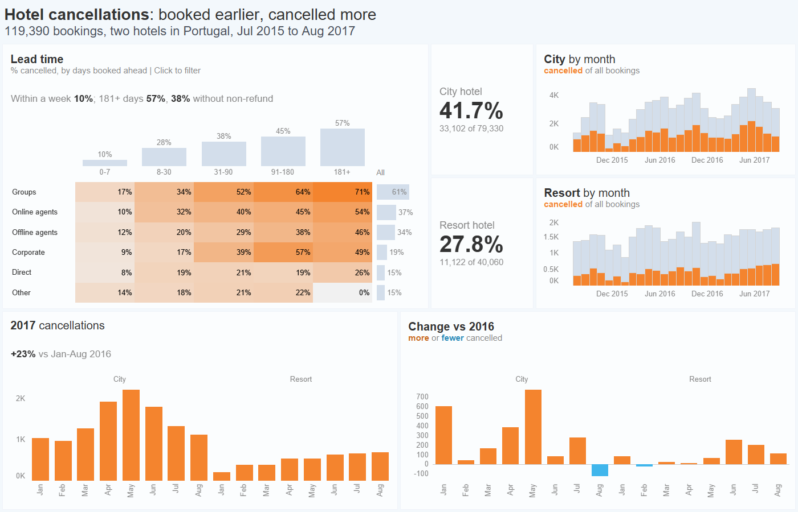

# twb-foundry

Builds a Tableau workbook in the style of workbooks you like and checks it in real Tableau Desktop.

It runs on Windows and needs Tableau Desktop 2025.1. You describe the workbook in a `spec.json`, or let Claude Code write it from an HTML mock. Deterministic code turns the spec into a `.twbx` using templates saved by Desktop, then the book goes through the checks below.



*The example below, from public data. `python examples/hotels/build.py` builds it with no work in Desktop.*

## Install

You need Windows, Tableau Desktop 2025.1 and Python 3.14, the version this is tested on. Clone this repo, then in its folder:

```
python -m venv .venv
.venv\Scripts\activate
pip install -r requirements.txt
```

If Desktop is not in `C:\Program Files\Tableau\Tableau 2025.1`, set `TABLEAU_EXE` to its `tableau.exe`, and before your first map run `python tools\geo_names.py "<Desktop folder>\Local\data\GeocodingData.hyper"` once.

## Run the example

```
python examples/hotels/build.py --desktop
```

It downloads the data, builds the book, runs the gate, recounts the numbers from the raw file, then opens the book in Desktop and compares what Desktop saves. Desktop starts minimized while this runs; leave it alone. It took about 4 minutes here. The book is `out/hotels/hotel_cancellations.twbx`. Without `--desktop` Desktop does not start. More: [examples/hotels/README.md](examples/hotels/README.md).

Another workbook made with these commands is [on Tableau Public](https://public.tableau.com/app/profile/vladimir.kravtsov/viz/KwikStarIowaNewStoresDriveLiquorSalesGrowth/KwikStarIowa). It is not in this repo and got edits by hand and by script after the build, so no command here repeats it. The command above builds the hotels workbook.

## Your own workbook

Open the repo in [Claude Code](https://claude.com/claude-code) and use, in this order or alone:

| Command | What it does |
|---|---|
| `/copy-style` | Takes colors, fonts and spacing from a workbook you like into a profile in `profiles/` |
| `/pick-charts` | Lists the sheets of workbooks you like, marks which the generator can build, saves your choice |
| `/draft-style` | Draws an HTML mock in the chosen style |
| `/to-tableau` | Turns the HTML mock and your data into a checked `.twbx` |

The commands under them: `python -m tbuilder --help`. Steps that read HTML need Google Chrome.

## What is checked

- **Gate:** reads the finished `.twbx` on its own, without the builder's code. A book that fails is not handed over.
- **Desktop:** `check-desktop --resave` opens the book in Desktop, shows every sheet, saves it again and reports what Desktop dropped or changed.
- **Numbers:** On the hotels example, 51 of the 52 numbers printed on the mock were confirmed automatically, by value and position, against values computed from the source data; 1 was accepted by hand with a reason. Unlabelled bars are checked by a separate script written for this workbook.

## Limitations

- Database sources are not supported yet (Databricks, SQL Server). Data comes from CSV or `.xlsx`.
- Windows and Desktop 2025.1 only. Other versions are not tested. Books are not checked on Server, Cloud or Tableau Public.
- Some sheets are marked `not supported yet` by `/pick-charts`. The generator does not build every form: the example applies five edits after the build, listed in its README.
- Floating dashboards give no layout.
- Only workbooks in English are tested.
- `/copy-style` and `/pick-charts` read other people's workbooks. Check their licence before you share what you build from them.

## Tests

```
python tools/ptest.py
python -m tbuilder regress --no-unit
```

Neither opens Desktop. `regress --desktop` opens every book, so it takes a while. `pandas` is only for recomputing the control numbers, see [golden/README.md](golden/README.md).

## License

MIT, see [LICENSE](LICENSE). Tableau's document schemas are included under Apache 2.0, see [NOTICE](NOTICE). Tableau is a trademark of Salesforce, Inc.; this project is not affiliated with or endorsed by Salesforce or Tableau.
